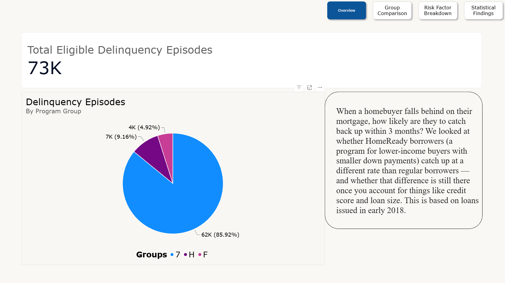
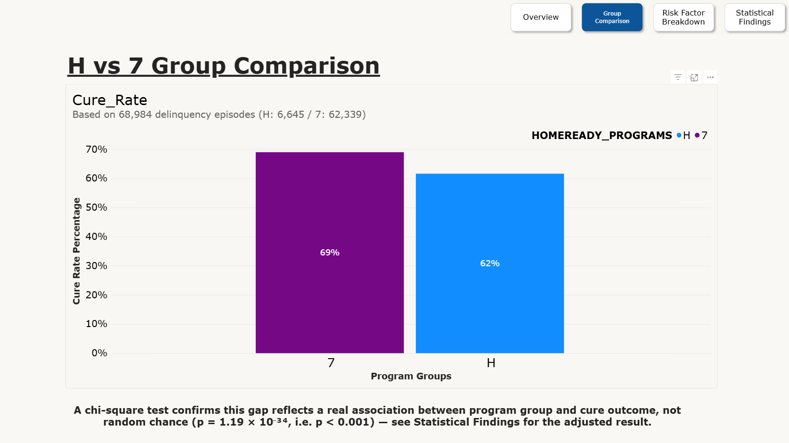
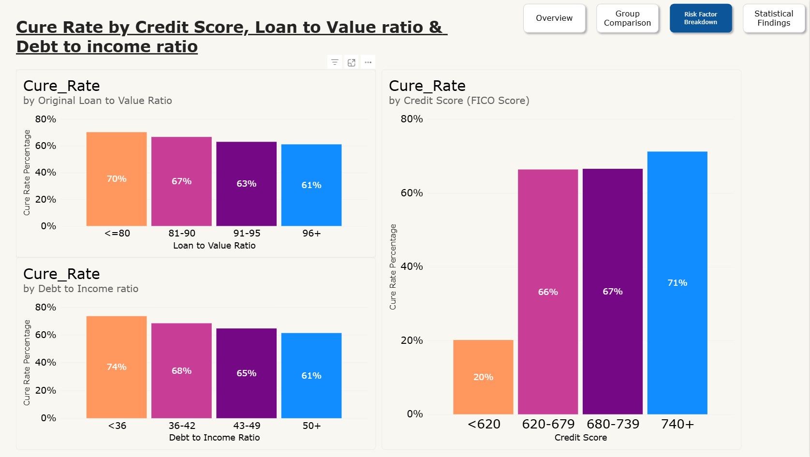
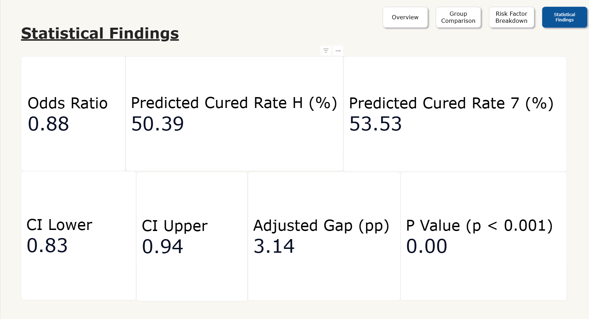

# Mortgage Delinquency Migration & Cure-Risk Analysis

**Fannie Mae Single-Family Loan Performance Data — 2018 Q1 Cohort**

## The Problem

When a homeowner misses mortgage payments, it doesn't automatically mean they're headed to foreclosure. Many borrowers catch up within a few months on their own. For a credit risk or loan servicing team, knowing which borrowers are likely to self-correct versus which need early intervention is a real, practical question — it shapes where resources and outreach get focused.

Fannie Mae's **HomeReady** program is built for lower-income borrowers, with smaller down payments and more flexible underwriting than a standard loan. This raises a natural question for a risk team: **if a HomeReady borrower falls behind, do they recover at a different rate than a standard borrower — and is that actually about the program, or just about the kind of borrower it tends to attract (lower credit scores, higher loan-to-value)?**

This project answers that question end to end: SQL for data cleaning and delinquency episode construction, Python for hypothesis testing and an adjusted logistic regression, and Power BI for presenting the results.

## Business Questions

1. How often do delinquent loans return to current status within 3 months?
2. Is there a real difference in cure rate between HomeReady and standard loans, or could the raw numbers just be noise?
3. How much of that difference is explained by borrower risk factors — credit score, loan-to-value, debt-to-income — rather than the program itself?
4. Which loan characteristics are most strongly associated with curing?
5. Is the remaining, risk-adjusted gap between the two groups still meaningful once those factors are controlled for?

## Key Findings

| Metric | Value |
|---|---|
| Raw cure rate — HomeReady | 61.6% |
| Raw cure rate — Standard | 69.0% |
| Raw gap | 6.6 percentage points |
| Statistical significance of raw gap (chi-square test) | p = 1.19 × 10⁻³⁴ |
| Adjusted odds ratio (HomeReady vs Standard) | 0.88 (95% CI: 0.83–0.94) |
| Adjusted cure rate — HomeReady | 50.39% |
| Adjusted cure rate — Standard | 53.53% |
| Adjusted gap | 3.14 percentage points |
| Statistical significance of adjusted gap | p < 0.001 |

**In plain terms:** HomeReady borrowers do cure less often than standard borrowers. But about half of that raw gap disappears once credit score, loan-to-value, and other risk factors are controlled for. A smaller, but still statistically significant, gap remains after that adjustment — meaning HomeReady status itself is associated with a somewhat lower chance of recovering from delinquency, independent of those other factors.

## Why This Matters

This is the kind of distinction a credit risk or servicing team needs before acting on a number: is a program riskier on its own merits, or does it just attract a riskier population? Conflating the two leads to the wrong conclusion — over-blaming a program, or under-pricing its actual risk. This analysis separates the two.

## Data

| Item | Detail |
|---|---|
| Source | Fannie Mae Single-Family Loan Performance Data |
| Cohort | 2018 Q1 acquisitions |
| Raw loan-month records | 23,563,399 |
| Columns used (of 113 available) | 22 |
| Unique loans in cohort | HomeReady = 30,863, HFA Preferred = 14,291, Standard (7) = 413,676 |
| Eligible delinquency episodes analyzed | 72,555 (verified: COUNT(\*) = COUNT(DISTINCT LOAN_ID) = 72,555) |
| Episodes by group | HomeReady = 6,645, Standard = 62,339, HFA Preferred = 3,571 |

HFA Preferred loans are a separate affordability program and were excluded from the core HomeReady-vs-standard comparison — they're included in the full population count on the dashboard's Overview page, but not in the regression.

The original raw source file (several gigabytes, pipe-delimited, 113 columns) is not included in this repository — Fannie Mae's terms of use don't permit redistributing it. The CSVs in `Dataset_for_PBi/` and `Sql Output/` are this project's own processed, loan-level outputs (episode data and model results), not the raw source file.

## Methodology

**1. Data cleaning** (`Sql Codes/SQLQuery1.sql`)
Converted the raw text file into proper data types, validated the row count matched the source exactly, and checked category values — like delinquency status codes — against Fannie Mae's official data dictionary.

**2. Delinquency episode construction** (`Sql Codes/SQLQuery2.sql`)
This was the core and most technically demanding step. A loan doesn't have "a delinquency" as a single flag — it has a run of consecutive delinquent months, starting from an earlier "current" month. Episode start points were identified carefully, excluding loans that were already delinquent the first time they appear in the data, since there's no way to confirm their true starting point. Each episode's outcome over the following 3 months was classified as Cured, Not Cured, Exited before completion, or Unknown, using both the delinquency status and the loan's exit reason code — so a loan that cured and then later paid off is still correctly counted as cured, not mislabeled. Output: `Sql Output/p1_primary_analysis.csv`.

**3. Statistical analysis** (`Python codes for Data Cleaning/P1.ipynb`, `P2.ipynb`)
- 95% confidence intervals for each group's raw cure rate.
- A correlation and variance inflation factor (VIF) check across loan characteristics — OLTV and OCLTV were found to be about 98% redundant with each other, so OLTV was retained and OCLTV dropped.
- A chi-square test confirming the raw cure-rate gap between groups is statistically real, not sampling noise.
- A logistic regression predicting cure outcome from program group plus credit score, loan-to-value, debt-to-income, loan age, starting delinquency severity, loan purpose, occupancy type, and a pre/post-COVID flag — run on the full eligible sample with no train/test split, since this is an explanatory model measuring adjusted association rather than a predictive one, and each loan contributes only a single episode.
- Exported three files to `Dataset_for_PBi/`: `Full_Population_Data.csv` (all HomeReady + Standard + HFA Preferred episodes, feeding the dashboard's Overview page), `H7_Comparison_Data.csv` (HomeReady vs Standard only, feeding the group comparison and risk-factor pages), and `Regression_Summary.csv` (the final model output).

**4. Power BI dashboard** (`Power BI Report/Mortgage-Delinquency-Migration-Cure-Risk-Analysis.pbix`)
A 4-page dashboard — Overview, Group Comparison, Risk Factor Breakdown, Statistical Findings. All statistics were calculated in Python beforehand; Power BI's role here is purely presentation and visualization, not calculation.

## Dashboard

**Overview**


**Group Comparison**


**Risk Factor Breakdown**


**Statistical Findings**


## Limitations

- **Correlational, not causal.** This analysis shows an association between HomeReady status and cure rate, not proof that program participation causes a lower cure rate.
- **Scoped to a single cohort.** Results are specific to loans originated in 2018 Q1 and may not generalize to other vintages or economic conditions.
- **"Standard" (coded 7) is a catch-all group, not a verified clean baseline.** It means "not flagged under any special eligibility program," which covers a wide range of borrowers rather than a single uniform population.
- **The observation window spans the COVID-19 period**, during which loan performance was affected by forbearance programs and broader economic disruption. A pre/post-COVID flag was included as a control, but this remains a relevant caveat when interpreting results.

## Tools Used

T-SQL · Python (Pandas, NumPy, SciPy, statsmodels) · Power BI (Power Query, DAX)

## Repository Structure

```
Dataset_for_PBi/                 — processed CSVs feeding the Power BI dashboard
Power BI Report/                 — the .pbix dashboard file
Python codes for Data Cleaning/  — Jupyter notebooks (statistical analysis and regression)
Sql Codes/                       — T-SQL scripts for data cleaning and episode construction
Sql Output/                      — episode-level dataset output from SQL
README.md
.gitignore
```
